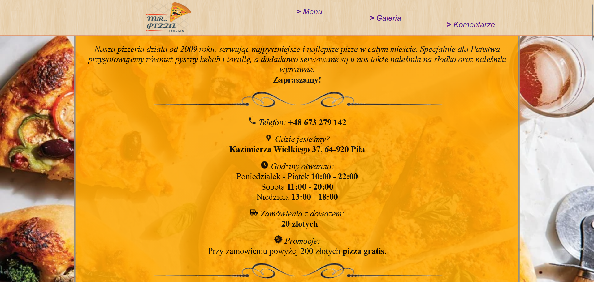
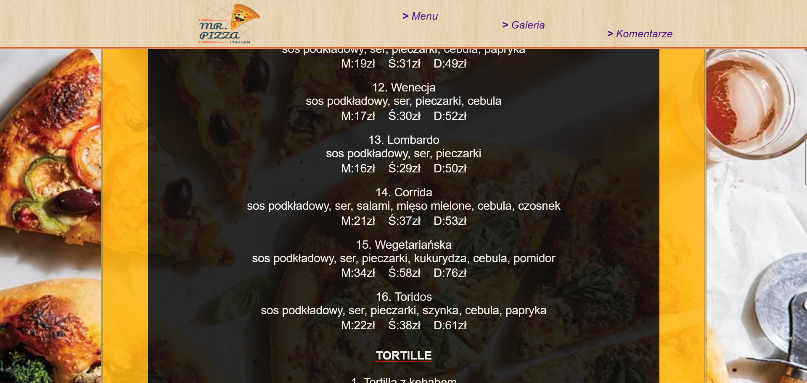
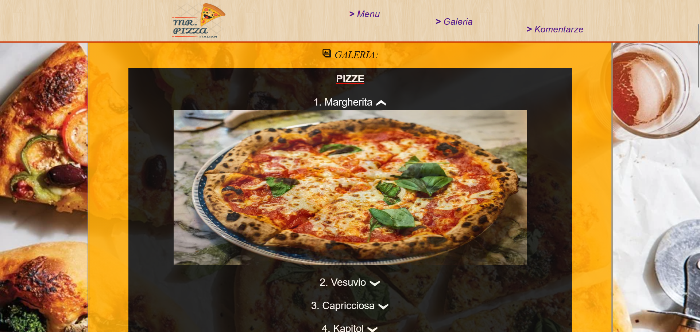
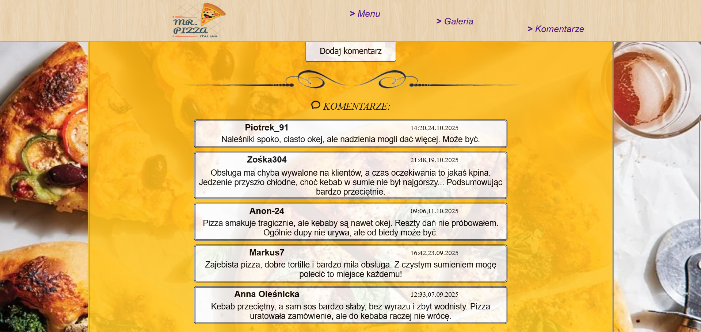

# ***[Projekt Pizza](https://szulczyk.pl/projekt-19/pizza)***

## 🖼️ ***Zrzuty ekranu***

 

## 📄 ***Opis projektu***
### ✅ *Projekt zakończony dnia 04.11.2025*
### *Projekt przedstawia gotową stronę internetową zmyślonej pizzerii Mr. Pizza. Serwis składa się z trzech kluczowych części: strony głównej, galerii oraz sekcji z komentarzami. Część główna zawiera najważniejsze informacje o lokalu oraz jego pełne menu. W galerii użytkownicy mogą obejrzeć zdjęcia oferowanych potraw. Z kolei sekcja komentarzy umożliwia zarówno przeglądanie opinii innych klientów, jak i dodawanie własnych recenzji.*

 

## 🛠️ ***Stack projektu***
- ### *Frontend*
  - ### *HTML5*
  - ### *CSS3*
  - ### *JQuery*
- ### *Backend*
  - ### *PHP*
- ### *Bazy danych*
  - ### *MySQL*

 

## 📌 ***Podsumowanie projektu***
### 🎯 *Głównym celem projektu było stworzenie przejrzystej i estetycznej strony internetowej pizzerii obejmującej kluczowe sekcje, takie jak menu, galeria czy komentarze. W ramach prac po raz pierwszy zintegrowałem witrynę z mapą Google oraz zaimplementowałem obsługę bazy danych MySQL do dynamicznego zapisu i pobierania opinii klientów.*
### 💡 *Czego się nauczyłem:*
- ### *Łączenie ikonek z tekstem - połączyłem małe ikony tematyczne z tekstem, co znacznie poprawiło wygląd strony oraz jej czytelność.*
- ### *Integracja z mapami Google - po raz pierwszy samodzielnie osadziłem mapę Google na stronie i ustawiłem na niej konkretny adres.*
- ### *Skalowanie i elastyczność grafiki - zastosowałem odpowiednie, procentowe dopasowanie rozmiaru obrazków, co zapewniło spójny wygląd elementów wizualnych.*
- ### *Ochrona danych wejściowych - utrwaliłem wiedzę z zakresu ochrony pól tekstowych poprzez ponowne zastosowanie tokenów CSRF oraz mechanizmu honeypot.*
- ### *Obsługa bazy danych - po raz pierwszy zastosowałem bazę MySQL do dynamicznego zapisywania, pobierania i wyświetlania komentarzy użytkowników na stronie.*

 

## 📨 ***Kontakt***
- ### 📧 *E-mail -* przemo.ppk@gmail.com
- ### 💻 *Discord -* darkcoder97